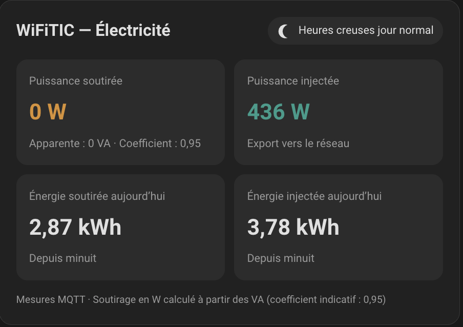
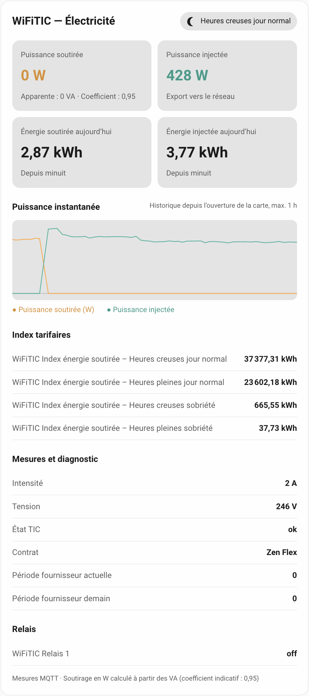

# 📊 WiFiTIC Lovelace Card

## 🏠 Mes projets Home Assistant

Retrouvez l'ensemble de mes intégrations et projets Home Assistant sur ma page dédiée :

[**🏠 Découvrir mes projets Home Assistant**](https://erra.me)

## ☕ Soutenir le projet

Si cette carte vous est utile et que vous souhaitez soutenir son développement et sa maintenance :

  

## ⚠️ Important

Carte Lovelace personnalisée **Home Assistant** conçue pour l'[intégration WiFiTIC](https://github.com/AuroreVgn/wifiTIC), destinée aux compteurs Linky équipés du module **[WiFiTIC de Cartelectronic](https://cartelectronic.fr/accueil/136-wifitic.html)**.

Elle a pour objectif de rassembler dans une carte les données électriques exposées par l'intégration : soutirage, injection et informations tarifaires.

> [!IMPORTANT]
> Ce projet communautaire est **non officiel**, indépendant de [Cartelectronic](https://cartelectronic.fr/accueil/136-wifitic.html), d'Enedis et de Home Assistant.

> [!WARNING]
> **La carte n'est pas encore distribuée :** le fichier JavaScript installable n'est pas présent dans ce dépôt. Les fonctionnalités et la configuration ci-dessous sont présentées comme des objectifs et seront confirmées à la publication du code.

## ✨ Fonctionnalités prévues

- Affichage des informations électriques issues de l'intégration WiFiTIC.
- Visualisation de la puissance soutirée et de l'injection vers le réseau.
- Présentation des index de consommation par période tarifaire.
- Affichage des informations de contrat et de période tarifaire lorsqu'elles sont disponibles.
- Présentation adaptée à un tableau de bord Lovelace.

Les éventuels modes d'affichage, options de personnalisation, actions et fonctions d'éditeur graphique seront documentés **après vérification du code JavaScript**.

## 📸 Aperçus

| Mode sombre | Mode clair |
| :---: | :---: |
|  |  |

Les images illustrent l'apparence du projet. Les fonctionnalités effectives dépendront de la version JavaScript publiée.

## 📋 Prérequis

La carte est conçue pour fonctionner avec l'intégration **[WiFiTIC pour Home Assistant](https://github.com/AuroreVgn/wifiTIC)**.

L'intégration récupère les informations du module via **MQTT** et l'**API REST locale**. Elle doit être installée et configurée avant d'utiliser la carte.

Les entités effectivement nécessaires à la carte seront précisées lorsque le code sera disponible.

## 🛡️ Compatibilité

- **Home Assistant** avec un tableau de bord Lovelace.
- **Intégration WiFiTIC** : [AuroreVgn/wifiTIC](https://github.com/AuroreVgn/wifiTIC).
- Données disponibles selon le contrat Linky et les informations remontées par le module.

Aucune version minimale de Home Assistant n'est annoncée tant que la carte n'a pas été testée et publiée.

## 📦 Installation

### Option A — HACS

> [!WARNING]
> **Pas encore disponible.** Le dépôt ne contient actuellement aucun composant JavaScript installable. L'ajouter à HACS ne suffit donc pas à installer une carte fonctionnelle.

Après publication du composant, cette rubrique précisera la procédure d'ajout du dépôt personnalisé dans **HACS → Frontend / Dashboard**.

### Option B — Installation manuelle

La procédure manuelle, le nom du fichier JavaScript et son URL de ressource Lovelace seront indiqués **après publication**. Aucun chemin de ressource n'est fourni à ce stade pour éviter une configuration invalide.

## ⚙️ Configuration minimale

La syntaxe YAML de la carte (`type: custom:...`) n'est pas encore confirmée par un fichier JavaScript publié. Elle sera ajoutée ici dès que le composant sera disponible.

## ⚙️ Exemple de configuration complète

Les options YAML et leurs valeurs par défaut seront documentées à partir de l'implémentation réelle, sans présumer de paramètres qui pourraient ne pas exister.

## 📊 Entités utilisées

La carte exploitera les données fournies par l'intégration WiFiTIC. Parmi les entités disponibles côté intégration :

| Information | Entité exposée par l'intégration |
| --- | --- |
| Puissance apparente soutirée | Puissance apparente soutirée |
| Puissance soutirée estimée | Puissance soutirée du réseau (estimée) |
| Puissance injectée | Puissance injectée sur le réseau |
| Index d'injection | Index énergie injectée au réseau |
| Index de soutirage | Index énergie soutirée – *nom de période* |
| Période en cours | Période tarifaire |
| Contrat | Contrat électrique |

Les identifiants `sensor.*` exacts peuvent dépendre des noms attribués par Home Assistant. **Ce tableau décrit l'intégration, pas encore une liste d'entités obligatoires pour la carte.**

## 🎛️ Modes d'affichage

Les captures disponibles présentent deux **thèmes** (clair et sombre). Elles ne prouvent pas l'existence de modes fonctionnels distincts tels que « détaillé » ou « compact ». Cette section sera complétée lors de la publication du composant.

## 🎨 Éditeur graphique

La présence et les options d'un éditeur visuel Home Assistant restent à confirmer à partir du JavaScript publié.

## 📱 Responsive / mobile

Le comportement sur mobile et les dimensions prises en charge seront précisés après tests du composant.

## 🛠️ Dépannage

### La carte n'apparaît pas

Vérifier d'abord que le fichier JavaScript de la carte a bien été publié et installé. **À ce stade, ce fichier est absent du dépôt.**

### Les données ne s'affichent pas

Vérifier dans **Outils de développement → États** que l'intégration WiFiTIC est opérationnelle et que ses capteurs reçoivent des valeurs. Les problèmes propres à l'affichage de la carte ne pourront être diagnostiqués qu'une fois son code disponible.

## 🤝 Contributions et problèmes

Les retours, corrections et propositions d'amélioration sont les bienvenus dans les [issues du dépôt WiFiTIC Card](https://github.com/AuroreVgn/wifiTIC_card/issues).

Pour faciliter l'analyse, indiquer la version de Home Assistant, celle de l'intégration WiFiTIC, le navigateur utilisé et les étapes permettant de reproduire le problème. Ne pas publier de données personnelles ni d'identifiants.

## 📄 Licence

Projet distribué sous licence [MIT](LICENSE).
